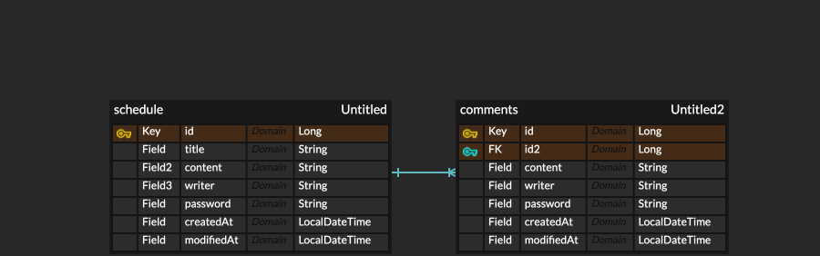

# ScheduleManagement

## 1. API 명세

### 1-1. 일정 생성

Method: POST

Path: /schedules

Request Body: title, content, writer, password

Response Body: id, title, content, writer, createdAt, modifiedAt

### 1-2. 일정 단건 조회

Method: GET

Path: /schedules/{id}

Response Body: id, title, content, writer, createdAt, modifiedAt, comments

### 1-3. 일정 전체 조회

Method: GET

Path: /schedules

Request Body: writer

Response Body: id, title, content, writer, createdAt, modifiedAt

### 1-4. 일정 수정

Method: PUT

Path: /schedules/{id}

Request Body: title, writer, password

Response Body: id, title, content, writer, createdAt, modifiedAt, comments

### 1-5. 일정 삭제

Method: DELETE

Path: /schedules/{id}

Request Body: password

Response Body: 204 No Content

## 2. ERD
    BaseEntity {
        LocalDateTime createdAt "생성일시"
        LocalDateTime modifiedAt "수정일시"
    }

    Schedule {
        Long id PK "고유 ID (Auto Increment)"
        String title "제목 (VARCHAR 30)"
        String content "내용 (VARCHAR 200)"
        String writer "작성자"
        String password "비밀번호"
    }

    Comment {
        Long id PK "고유 ID (Auto Increment)"
        Long scheduleId FK "일정 ID"
        String content "내용 (VARCHAR 100)"
        String writer "작성자"
        String password "비밀번호"
    }

